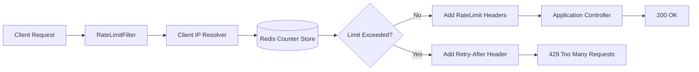
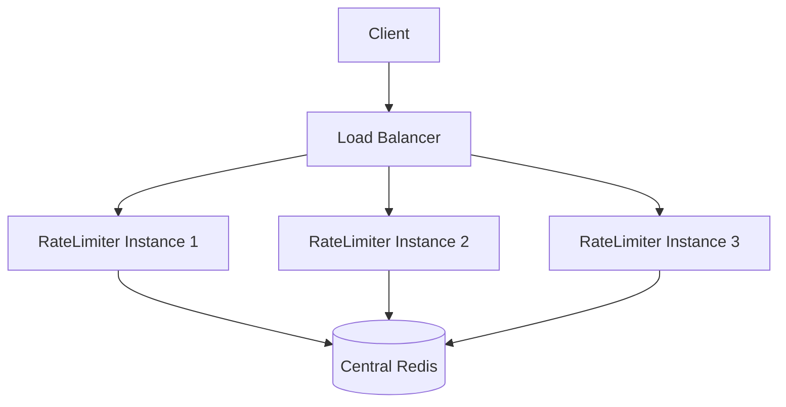
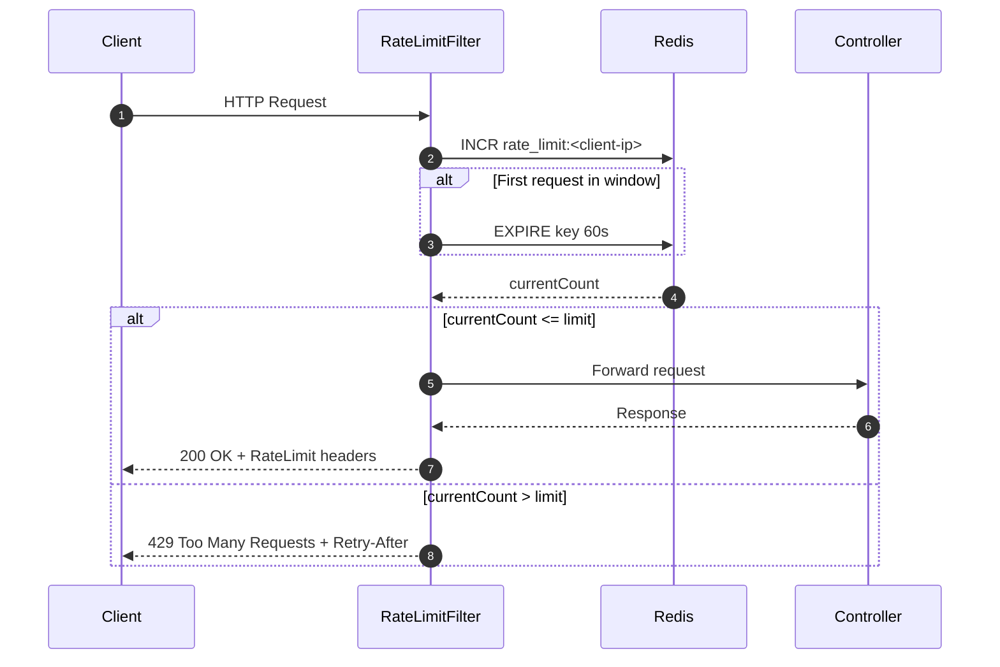
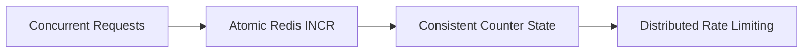
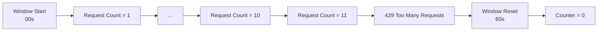

# Distributed Rate Limiter

A high-performance, distributed rate limiting solution built with **Spring WebFlux** and **Redis**.

Designed for:

* API protection
* brute-force mitigation
* fair usage enforcement
* distributed traffic control

---

# Features

* Reactive non-blocking request filtering with Spring WebFlux
* Distributed request counting using Redis
* Fixed Window rate limiting algorithm
* Atomic Redis `INCR` operations
* Configurable request limits and window durations
* Rate limit response headers
* `429 Too Many Requests` handling
* Trusted proxy / `X-Forwarded-For` support
* Dockerized Redis infrastructure
* Unit + integration testing support

---

# Architecture



---

# Distributed Scaling Model



> All application instances share the same centralized Redis counters, enabling distributed rate limiting across horizontally scaled deployments.

---

# Request Flow



---

# Why Redis?



Redis is used because it provides:

* extremely fast in-memory operations
* atomic increment support
* centralized distributed state
* low-latency request counting

---

# Tech Stack

| Layer          | Technology                         |
| -------------- | ---------------------------------- |
| Framework      | Spring Boot + Spring WebFlux       |
| Runtime        | Netty (non-blocking I/O)           |
| State Store    | Redis (Reactive Lettuce Client)    |
| Language       | Java 17                            |
| Testing        | JUnit 5 + Mockito + Testcontainers |
| Infrastructure | Docker / Docker Compose            |

---

# Algorithm: Fixed Window Counter



## Trade-off

The Fixed Window algorithm is:

* simple
* fast
* memory efficient

However, it allows burst traffic at window boundaries.

Example:

* 10 requests at second 59
* 10 requests at second 60

This may temporarily allow up to 2× the configured limit.

---

# Quick Start

## 1. Start Redis

```bash
docker-compose up -d
```

---

## 2. Run the Application

### Windows

```bash
.\mvnw.cmd spring-boot:run
```

### Linux / macOS

```bash
./mvnw spring-boot:run
```

Application starts at:

```text
http://localhost:8080
```

---

## 3. Test the API

### Normal Request

```bash
curl -i http://localhost:8080/api/test
```

### Response Headers

```http
X-RateLimit-Limit: 10
X-RateLimit-Remaining: 9
```

---

### After Exceeding the Limit

```http
HTTP/1.1 429 Too Many Requests

Retry-After: 60

{
  "error": "Too Many Requests",
  "message": "Rate limit exceeded. Please try again later."
}
```

---

# Configuration

All limits are configurable through `application.properties`.

```properties
rate-limiter.request-limit=10
rate-limiter.window-minutes=1
rate-limiter.trusted-proxies=127.0.0.1,0:0:0:0:0:0:0:1
```

---

# Response Headers

| Header                  | Description                                 |
| ----------------------- | ------------------------------------------- |
| `X-RateLimit-Limit`     | Configured maximum requests                 |
| `X-RateLimit-Remaining` | Remaining requests in current window        |
| `Retry-After`           | Seconds until next available request window |

---

# Running Tests

## Unit Tests

```bash
.\mvnw.cmd test -Dtest="RateLimiterServiceTest,RateLimitFilterTest"
```

---

## Integration Tests

```bash
.\mvnw.cmd test -Dtest="RateLimitIntegrationTest"
```

---

## Run All Tests

```bash
.\mvnw.cmd test
```

---

# Monitoring Redis State

## Open Redis CLI

```bash
docker exec -it redis-limiter redis-cli
```

---

## List Rate Limit Keys

```bash
KEYS rate_limit:*
```

---

## Read Current Counter

```bash
GET rate_limit:fixed:192.168.1.1
```

---

## Check Remaining TTL

```bash
TTL rate_limit:fixed:192.168.1.1
```

---

# Future Improvements

* Sliding Window algorithm
* Token Bucket implementation
* Per-user JWT-based limiting
* Dynamic quotas
* Prometheus + Grafana metrics
* Distributed tracing
* Redis Lua scripts for advanced atomicity
* Spring Cloud Gateway integration

---

# Concepts Demonstrated

* Reactive Programming
* Distributed Systems
* API Protection
* Non-blocking I/O
* Atomic Operations
* Horizontal Scalability
* Redis-based Distributed State
* Traffic Shaping
* Observability Foundations
